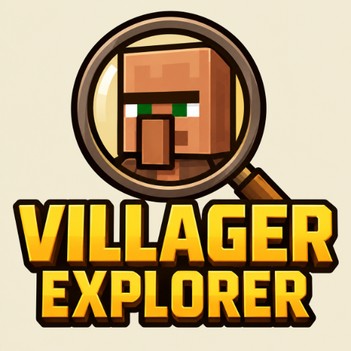
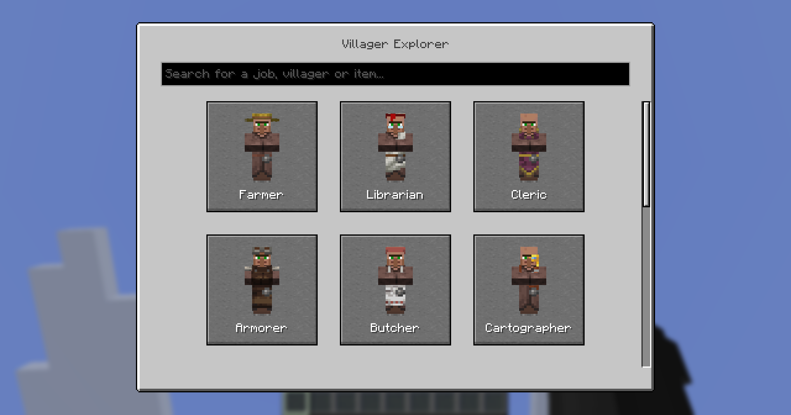
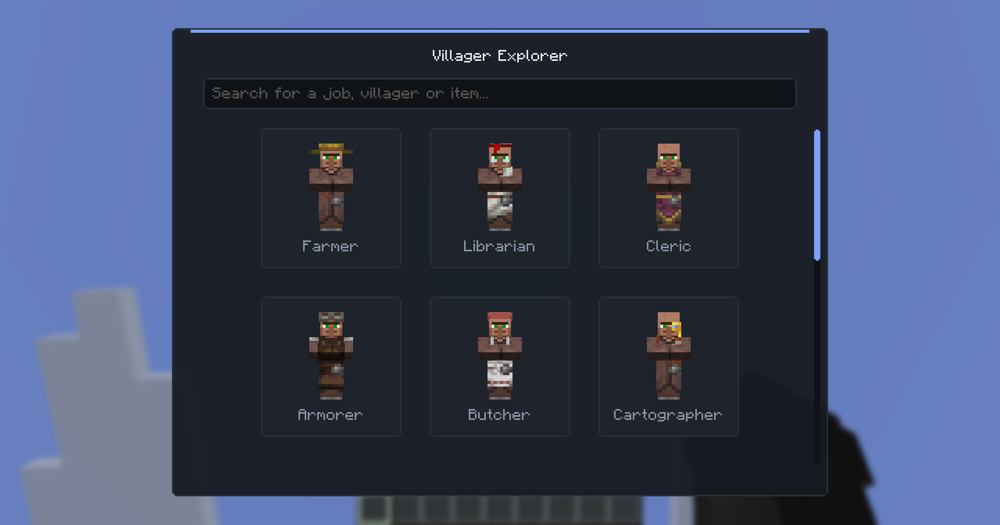
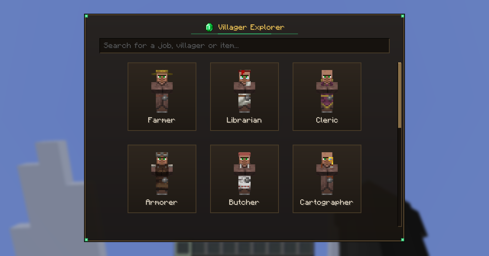
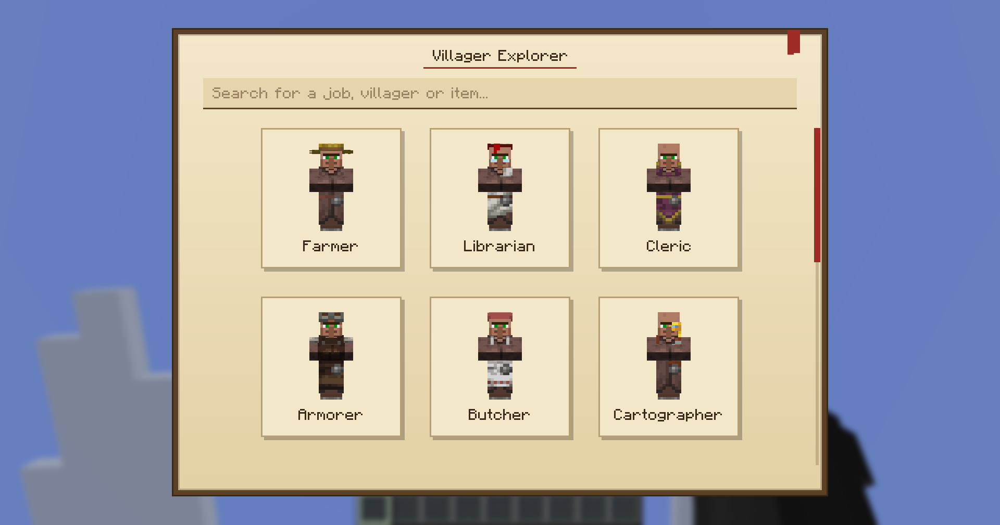

<p align="center">
  
</p>

<h1 align="center">Villager Explorer</h1>

A client-side mod for Minecraft 26.3 that shows you everything villagers and the wandering trader have to offer. Available for Fabric and NeoForge.

<p align="center">
  <a href="https://modrinth.com/mod/villagerexplorer">
    
  </a>
  <a href="https://www.curseforge.com/minecraft/mc-mods/villagerexplorer">
    
  </a>
</p>

## What it does

Press `V` and you get an overview of every profession. Pick one and you see all of its trades sorted by level, together with the job site block and its crafting recipe. No more guessing which villager sells what or digging through the wiki in the middle of building a trading hall.

The trade data comes straight from the vanilla game files, so prices, max uses and villager XP match what you see in survival.

## Features

### Trade overview
Every trade a profession can offer, grouped by level. Hovering an item shows its normal tooltip plus max uses, villager XP, the price range for enchanted items and things like random enchantments or dye colors.

### Pinned trades
Click the star next to a trade to pin it. Pinned trades stay visible in a small widget on your screen, which is handy when you are hunting for a specific book. Open the chat to move the widget around or remove entries.

### Quick open
Look at a villager or wandering trader and press `V` to jump straight to its trades, with the right profession and biome already selected.

### GUI styles
Choose between Vanilla, Modern, Refined and Ledger. The pinned trades widget follows the style you pick, and the GUI scales down on small screens and high GUI scales.

<p align="center">
  
  
  <br>
  
  
</p>

## Settings

You can change the key in Minecraft's controls menu. The GUI style can be picked through Mod Menu on Fabric, the mod list on NeoForge or the command `/villagerexplorer style`. If you already know which one you want, `/villagerexplorer style <vanilla|modern|refined|ledger>` sets it directly.

All settings, including your pinned trades and the widget position, are saved in `config/villagerexplorer.properties`.

## Building from source

The project uses a MultiLoader setup. Shared code lives in `common`, while `fabric` and `neoforge` only contain the small loader specific parts.

```
./gradlew build                 builds both jars into fabric/build/libs and neoforge/build/libs
./gradlew :fabric:runClient     starts a Fabric dev client
./gradlew :neoforge:runClient   starts a NeoForge dev client
```

After a Minecraft update the trade data can be regenerated from the new game jar:

```
python tools/generate_trades.py <minecraft.jar> common/src/main/resources/assets/villagerexplorer/trades.json
```

## License

MIT, see [LICENSE.txt](LICENSE.txt).
